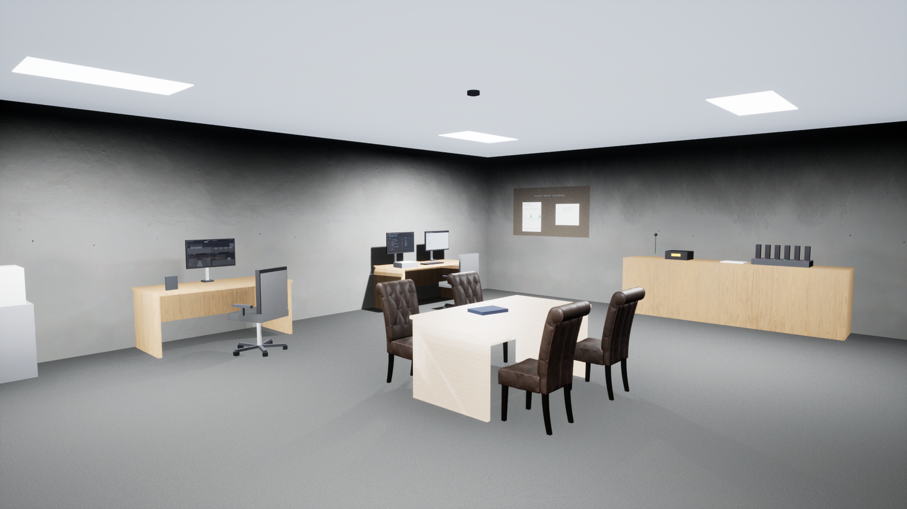
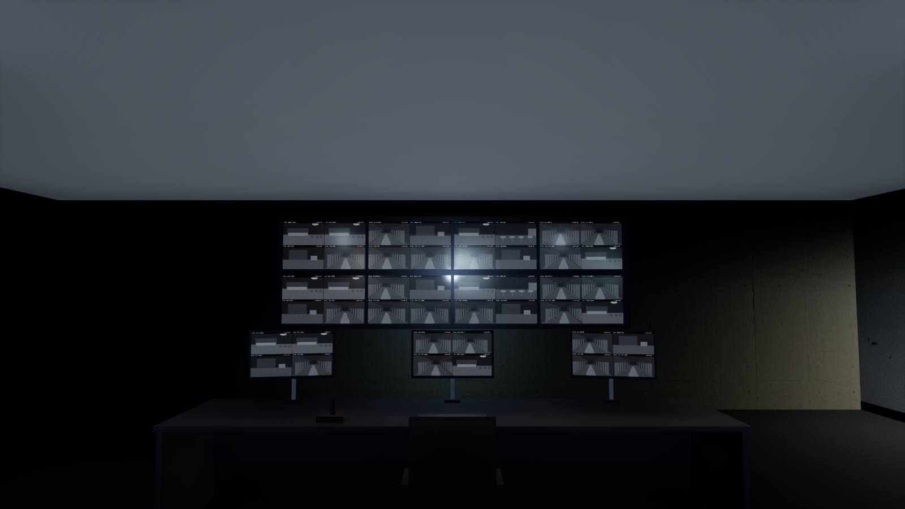
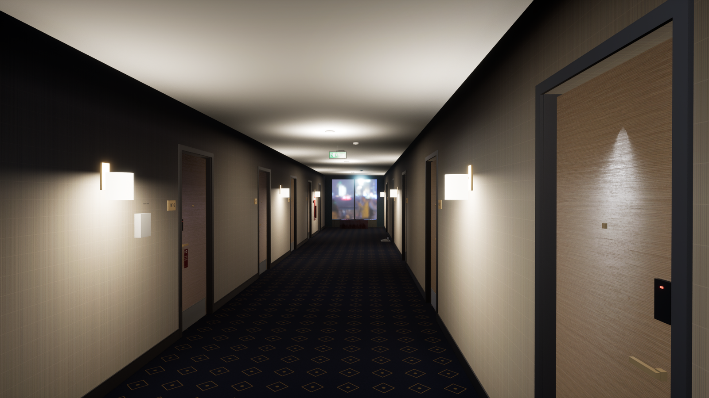

# Keycard

**From the night shift to Vice President, Global Safety & Security.**

Keycard is a first-person career simulator about hotel Loss Prevention. You join the LP team at the Veldane Grand Harbourfront as a night-shift officer. You climb ten career levels by doing the real job: answering the radio, walking to the scene, talking to people face to face, pulling lock audit trails, reviewing CCTV, keeping chain of custody, running fire and life safety, handling claims and investigations, and leading through crises.

Every case teaches a real procedure. After you file your report, the debrief explains what a strong LP professional would have done, and why.

[**Download Keycard 1.0.0 for Windows**](https://github.com/mutima89/keycard/releases/tag/v1.0.0) · offline · single-player · Unreal Engine 5.8 · sister game to [Riskbound](https://github.com/mutima89/riskbound)


## The job
| | |
|---|---|
|  |  |
| **Sign on in the LP office.** Calls come in by radio, phone and email, and the case clock starts. | **Review the footage before it overwrites.** Step through clips, export them with their hashes, and log custody. |
|  |  |
| **Walk the building.** One multi-floor hotel, linked by lifts and stairs, from B1 back of house to the guest floors. | **Fire and life safety.** Read the panel, investigate the zone, manage impairments, and evacuate when you must. |

## What's in 1.0.0
- **39 cases across ten levels.** That's 34 ladder cases and four career crises (a power outage at full occupancy, a bomb threat call, a fire on a guest floor and a hurricane), with the capstone *One Night, Three Hotels* at the end.
- **A hidden rubric across seven dimensions.** It's scored only when you file, then a debrief teaches best practice and the common mistakes.
- **Decisions come back.** Weak calls schedule seeded later events (claims, grievances, findings, press) that name the decision behind them.
- **Promotion on evidence.** Competence and passed cases count, never XP or relationships.
- **Eleven endings**, a performance review and a certificate you can save.
- **47 Field Manual cards** and a 47-term glossary.
- **Challenge modes:** survival night shift, daily cases (the same three for everyone on a date) and classroom sets for trainers, with a local leaderboard.
- **380 voiced lines**, all generated offline.

| | |
|---|---|
|  |  |
|  |  |

## The Veldane policy
Observe, report, de-escalate. Physical intervention, searches and detention follow policy and local law only. Breaking policy is scored and has consequences.

## System requirements
Windows 10/11 x64. Target PC: GTX 1650 4 GB, 1920x1080 at High, 60 fps. About 0.7 GB on disk.

The build is unsigned, so Windows SmartScreen will warn you. Choose **More info**, then **Run anyway**.

## Building from source
```
Scripts/run_core_tests.sh                    # simulation core tests (Linux/macOS, ASan + UBSan)
Scripts\RunCoreTests.bat                     # the same on Windows
Scripts\RunUnrealTests.bat <UE dir>          # UE automation tests
Scripts\BuildWindows.bat <UE dir> Shipping   # package -> Release\Shipping\Windows\Keycard.exe
powershell -File Scripts\RunWalkthrough.ps1 -Exe <Keycard.exe>   # full career and challenge walkthrough
```
For the architecture, see [Docs/Architecture.md](Docs/Architecture.md). The LP formulas are in [Docs/LpMethodology.md](Docs/LpMethodology.md), and progress and test results are in [Docs/Progress.md](Docs/Progress.md).

## Names are fictional
Veldane Hotels & Resorts and every property, company, product and person in Keycard are invented, and each name is checked before use ([Docs/FictionalNames.md](Docs/FictionalNames.md)). Keycard is training-style fiction about widely published hotel security practice. It is not legal advice; follow local law and your organisation's policies.

## Licence and credits
Code: MIT ([LICENSE](LICENSE)). Created by M A Almahlaki. Third-party assets and their licences are listed in [Docs/AssetCredits.md](Docs/AssetCredits.md).
