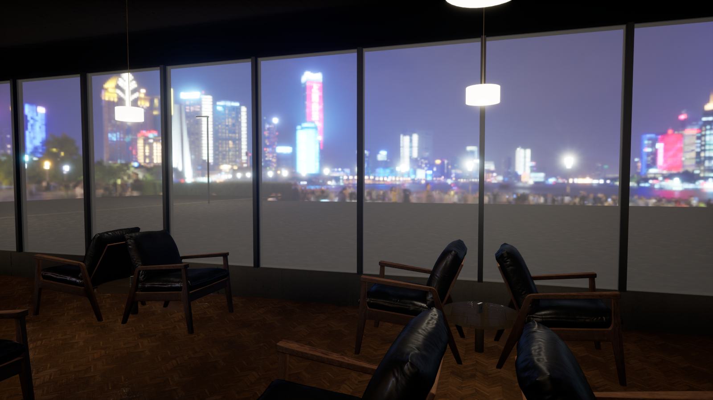
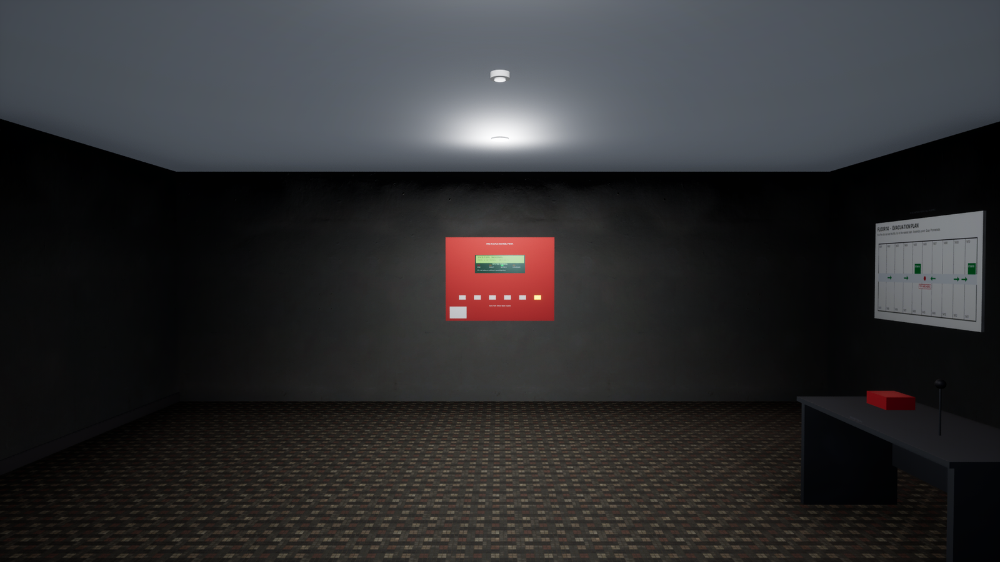
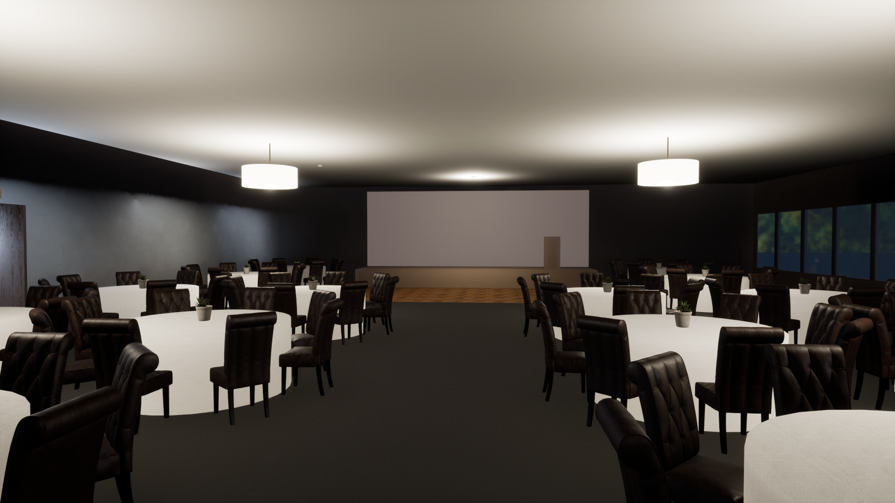
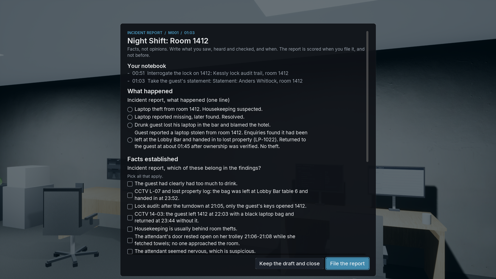
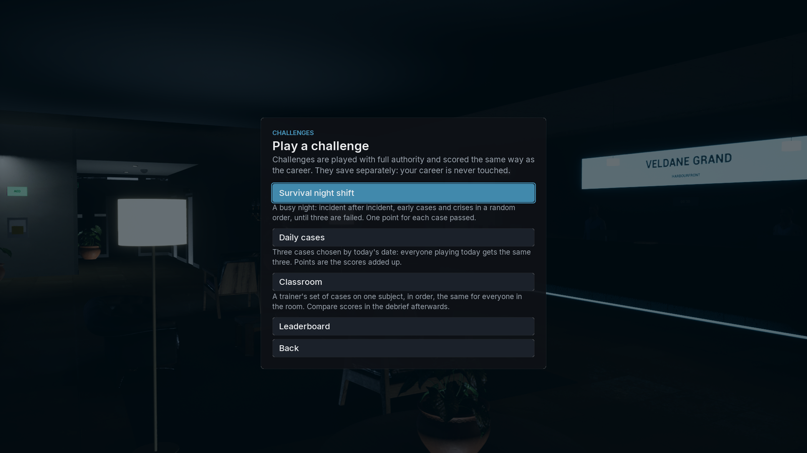

<div align="center">

# KEYCARD

### A hotel Loss Prevention career simulator

*From the night shift to Vice President, Global Safety & Security.*

[](https://github.com/mutima89/keycard/releases/latest)
[](#system-requirements)
[](https://www.unrealengine.com)
[](LICENSE)

**[Download](https://github.com/mutima89/keycard/releases/latest)** · **[Features](#features)** · **[Screenshots](#screenshots)** · **[Build from source](#build-from-source)** · **[Documentation](#documentation)**

<br>



</div>

<br>

## Overview

**Keycard** is a first-person, single-player career simulator set in the Loss Prevention department of the Veldane Grand Harbourfront, a fictional luxury hotel. You start as a night-shift LP Officer and rise through ten career levels to Vice President, Global Safety & Security.

There are no shortcuts and no combat. You progress by doing the job well: answering the radio, walking to the scene, interviewing people face to face, pulling lock audit trails, reviewing CCTV, keeping chain of custody, running fire and life safety, handling claims and investigations, and leading through crises.

Every case teaches a real, widely published procedure. When you file your report, a debrief explains what a strong LP professional would have done, and why.

> **Veldane policy:** observe, report, de-escalate. Physical intervention, searches and detention follow policy and local law only. Breaking policy is scored and has consequences.

<br>

## Features

- **One living building:** Explore a multi-floor hotel linked by lifts and stairs, from back-of-house B1 and the lobby to the Harbour Ballroom, executive floor, and guest floors. Every case is played on foot against a running case clock.
- **Real investigative tools:** Use lock audit trails, CCTV review and export with hashes, evidence bags and custody logs, fire panels, claim reserves, and incident costing. Formulas are centralized and documented.
- **A hidden rubric:** Each case is scored across procedure, evidence, compliance, care, communication, cost, and report—only after you file.
- **Decisions come back:** Weak calls can schedule seeded later events, including claims, grievances, fire authority findings, insurer letters, and press coverage, each naming the decision behind it.
- **Promotion on evidence:** Promotion depends on competence and passed cases, and from level 6 on a career crisis—not XP or relationships.
- **Built to teach:** 47 Field Manual cards, a 47-term glossary, and a debrief after every case covering best practice, the reasons behind it, and common mistakes.

### Content in 1.0.0

| | |
|---|---|
| **Career** | 10 levels · 34 ladder cases · 4 career crises · the capstone *One Night, Three Hotels* |
| **Crises** | Power outage at full occupancy · Bomb threat call · Fire on a guest floor · Hurricane at the Cliffside Resort |
| **Endings** | 11 endings shaped by how you worked, with a performance review and a saveable certificate |
| **Modes** | Career · Survival night shift · Daily cases · Classroom sets for trainers · Local leaderboard |
| **Voice** | 380 voiced lines, generated fully offline |
| **Accessibility** | Text scale · Colour-safe palette · Reduced motion · Invert Y · Mouse and gamepad sensitivity · Frame cap and upscaling |

<br>

## Screenshots


*The LP office. Sign on, take the call, and the case clock starts.*


*CCTV control room. Review the footage before it overwrites.*


*Floor 14. Guest rooms, door alarms and a lock to audit.*



*Fire command centre. Read the panel, investigate the zone, decide.*



*The Harbour Ballroom. Banquets, occupant load and a bomb threat.*



*The incident report. Your rubric is hidden until you file.*



*Challenges. Survival, daily and classroom modes.*


*The ending. The career you earned, and a certificate.*

<br>

## Getting started

Download the latest release from the [GitHub Releases page](https://github.com/mutima89/keycard/releases/latest):

- **Installer — `Keycard-Setup-1.0.0.exe`:** Choose this for a guided Windows installation and Start menu entry.
- **Portable — `Keycard-1.0.0-Win64-Portable.zip`:** Choose this if you prefer not to install; extract the ZIP to a folder you can write to, then run `Keycard.exe`.

Both downloads run locally and work offline. After launching, choose **New career**, pick a difficulty and background, then sign on at the LP office terminal.

### Troubleshooting

- **Windows SmartScreen warns at launch:** The release is not code-signed. If you downloaded it from the official release page and choose to proceed, select **More info**, then **Run anyway**. Check the download's SHA-256 against the value published on the release page.
- **The game will not start or runs poorly:** Confirm you are on 64-bit Windows 10/11 and meet the published target below. Update your graphics driver, try the default graphics settings, and make sure the game files were fully extracted. If it still fails, report it in [GitHub Issues](https://github.com/mutima89/keycard/issues) with your Windows version, GPU, steps to reproduce, and any relevant log from `%LOCALAPPDATA%\Keycard\Saved\Logs`.
- **A save will not load:** Keycard first tries the primary save, then attempts recovery from its backup. If it reports that both are damaged, preserve the files in `%LOCALAPPDATA%\Keycard\Saved\SaveGames` before troubleshooting or reinstalling, and attach the message and steps that led to the problem to an issue. Do not post personal data from a save publicly.
- **Found a bug or have a suggestion?** Search existing [issues](https://github.com/mutima89/keycard/issues) first, then open a new issue with the game version and reproducible details. Keycard is offline, so include no expectation of telemetry or an in-game report upload.

## System requirements

The project documents a tested/target configuration, but does not publish a separately validated minimum specification. Treat the GPU and performance row below as the target, not a guarantee of minimum hardware support.

| | Published target |
|---|---|
| **OS** | Windows 10 / 11, 64-bit |
| **GPU** | NVIDIA GTX 1650 4 GB or equivalent (DirectX 11 / SM5) |
| **Performance target** | 1920×1080, High preset, 60 fps |
| **Storage** | About 0.7 GB installed |
| **Network** | None. Keycard runs fully offline. |

<br>

## Build from source

**Prerequisites:** Unreal Engine 5.8, Visual Studio 2022 (MSVC 14.4x), CMake 3.20+, and Python 3.10+. Inno Setup 6 is needed only to build the installer. Run the commands below from the repository root. The standalone simulation-core test does not require Unreal Engine.

```powershell
# Simulation core tests (no Unreal needed)
Scripts\RunCoreTests.bat
# Linux / macOS (requires CMake and a C++ compiler; enables ASan + UBSan)
Scripts/run_core_tests.sh

# Unreal automation tests (replace this with your UE 5.8 install directory)
Scripts\RunUnrealTests.bat "C:\Program Files\Epic Games\UE_5.8"
# Report: Saved\TestReport; log: Saved\Logs\KcTests.log

# Package a Windows Shipping build
Scripts\BuildWindows.bat "C:\Program Files\Epic Games\UE_5.8" Shipping
# Output: Release\Shipping\Windows\Keycard.exe (plus staged package files)

# Full input-free walkthrough: career through the capstone, then a daily challenge
powershell -ExecutionPolicy Bypass -File Scripts\RunWalkthrough.ps1 -Exe Release\Shipping\Windows\Keycard.exe
```

### Project layout

```text
Source/KeycardSim/   Engine-independent C++17 simulation core (career, LP formulas, scoring, saves)
Source/Keycard/      Unreal gameplay and presentation (hotel, people, interaction, Slate UI)
Tests/Core/          Core unit tests, built with CMake
Data/                Missions, people, events, endings and voice cast as validated JSON
Scripts/             Build, test, content, voice and asset pipelines
Docs/                Design, methodology, data formats and progress
```

The simulation core is deterministic: random events use a seeded RNG only, and every LP formula lives in `KcLpMath` and is documented in [LpMethodology.md](Docs/LpMethodology.md). Content in `Data/` is validated on load and by the test suite; invalid content fails validation.

<br>

## Documentation

| Document | Contents |
|---|---|
| [Game design](Docs/GameDesign.md) | Vision, career ladder, phases |
| [Career model](Docs/CareerModel.md) | Levels, competencies, promotion rules |
| [LP methodology](Docs/LpMethodology.md) | Every formula and why it works the way it does |
| [Mission data](Docs/MissionData.md) | Authoring and validating cases |
| [Architecture](Docs/Architecture.md) | Core and engine layers, data flow |
| [Save format](Docs/SaveFormat.md) | Versions and migrations |
| [Progress](Docs/Progress.md) | Build, test and release history |
| [Changelog](CHANGELOG.md) | What's in each release |

<br>

## Disclaimer

Veldane Hotels & Resorts and every property, company, product and person in Keycard are fictional. Each name is checked before use ([FictionalNames.md](Docs/FictionalNames.md)). Keycard is training-style fiction about widely published hotel security practice. It is **not legal advice** and does not describe any real organisation's procedures. Always follow local law and your own organisation's policies.

## Credits and licence

Created by **M A Almahlaki**. Sister project to [Riskbound](https://github.com/mutima89/riskbound).

The **source code** is released under the [MIT License](LICENSE). That permission applies to the code, not automatically to every asset shipped with the game. Third-party characters, textures, models, music, fonts, and voice-model materials have their own licences and attribution or redistribution terms; check [AssetCredits.md](Docs/AssetCredits.md) before reusing or redistributing any of them. The asset credits list sources and licences, including CC0, CC BY, MIT, Apache 2.0, and SIL Open Font License material.
