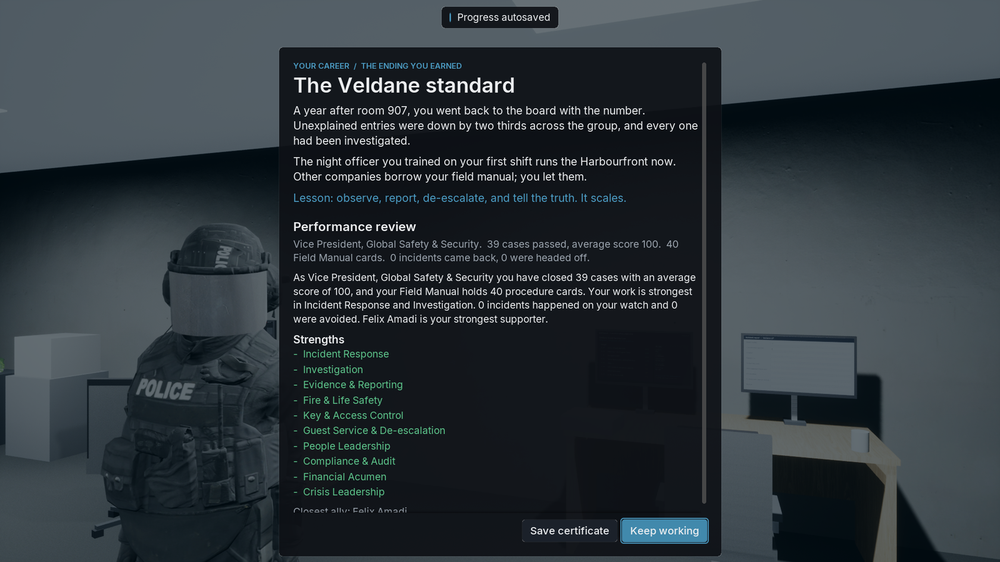

<div align="center">

# KEYCARD

### A hotel Loss Prevention career simulator

*From the night shift to Vice President, Global Safety & Security.*

[](https://github.com/mutima89/keycard/releases/latest)
[](https://github.com/mutima89/keycard/releases)
[](#system-requirements)
[](https://www.unrealengine.com)
[](LICENSE)

**[Download](https://github.com/mutima89/keycard/releases/latest)** · **[Features](#features)** · **[Screenshots](#screenshots)** · **[Build from source](#build-from-source)** · **[Documentation](#documentation)**

<br>


</div>

<br>

## Overview

**Keycard** is a first-person, single-player career simulator set in the Loss Prevention department of the Veldane Grand Harbourfront, a fictional luxury hotel. You start as a night-shift LP Officer and rise through ten career levels to Vice President, Global Safety & Security.

There are no shortcuts and no combat. You progress by doing the job well: answering the radio, walking to the scene, interviewing people face to face, pulling lock audit trails, reviewing CCTV, keeping chain of custody, running fire and life safety, handling claims and investigations, and leading through crises.

Every case teaches a real, widely published procedure. When you file your report, a debrief explains what a strong LP professional would have done, and why.

> **Veldane policy:** observe, report, de-escalate. Physical intervention, searches and detention follow policy and local law only. Breaking policy is scored and has consequences.

<br>

## Features

<table>
<tr>
<td width="50%" valign="top">

### 🏨 One living building
A single multi-floor hotel linked by lifts and stairs: back-of-house B1, the lobby, kitchen and front desk, the Harbour Ballroom, executive floor and boardroom, and the guest floors. Every case is played on foot, against a running case clock.

### 🔍 Real investigative tools
Lock audit trails, CCTV review and export with hashes, evidence bags and custody logs, fire panels, claim reserves and incident costing. Every formula lives in one place and is documented.

### 📋 A hidden rubric
Each case is scored across seven dimensions (procedure, evidence, compliance, care, communication, cost and report), and only after you file. You never see what's being measured while you work.

</td>
<td width="50%" valign="top">

### ⏳ Decisions come back
Weak calls schedule seeded later events, such as claims, grievances, fire authority findings, insurer letters and press coverage, each naming the decision behind it.

### 📈 Promotion on evidence
Promotion depends on competence, passed cases and, from level 6, a career crisis. XP and relationships never decide it.

### 🎓 Built to teach
47 Field Manual cards, a 47-term glossary, and a debrief after every case covering best practice, the reasons behind it and the common mistakes.

</td>
</tr>
</table>

### Content in 1.0.0

| | |
|---|---|
| **Career** | 10 levels · 34 ladder cases · 4 career crises · the capstone *One Night, Three Hotels* |
| **Crises** | Power outage at full occupancy · Bomb threat call · Fire on a guest floor · Hurricane at the Cliffside Resort |
| **Endings** | 11 endings shaped by how you worked, with a performance review and a saveable certificate |
| **Modes** | Career · Survival night shift · Daily cases · Classroom sets for trainers · Local leaderboard |
| **Voice** | 380 voiced lines, generated fully offline |
| **Accessibility** | Text scale · Colour-safe palette · Reduced motion · Invert Y · Mouse and gamepad sensitivity · Frame cap and upscaling |

<br>

## Screenshots

<table>
<tr>
<td width="50%"><br><sub><b>The LP office.</b> Sign on, take the call, and the case clock starts.</sub></td>
<td width="50%"><br><sub><b>CCTV control room.</b> Review the footage before it overwrites.</sub></td>
</tr>
<tr>
<td width="50%"><br><sub><b>Floor 14.</b> Guest rooms, door alarms and a lock to audit.</sub></td>
<td width="50%"><br><sub><b>Fire command centre.</b> Read the panel, investigate the zone, decide.</sub></td>
</tr>
<tr>
<td width="50%"><br><sub><b>The Harbour Ballroom.</b> Banquets, occupant load and a bomb threat.</sub></td>
<td width="50%"><br><sub><b>The incident report.</b> Your rubric is hidden until you file.</sub></td>
</tr>
<tr>
<td width="50%"><br><sub><b>Challenges.</b> Survival, daily and classroom modes.</sub></td>
<td width="50%"><br><sub><b>The ending.</b> The career you earned, and a certificate.</sub></td>
</tr>
</table>

<br>

## Getting started

1. Download **`Keycard-Setup-1.0.0.exe`** (installer) or **`Keycard-1.0.0-Win64-Portable.zip`** from the [latest release](https://github.com/mutima89/keycard/releases/latest).
2. Run the installer, or unzip the portable build anywhere and launch `Keycard.exe`.
3. Choose **New career**, then pick a difficulty and a background, and sign on at the LP office terminal.

> [!NOTE]
> The build is not code-signed, so Windows SmartScreen may warn you on first launch. Select **More info**, then **Run anyway**. You can compare each download's SHA-256 with the value on the release page.

## System requirements

| | Minimum (target) |
|---|---|
| **OS** | Windows 10 / 11, 64-bit |
| **GPU** | NVIDIA GTX 1650 4 GB or equivalent (DirectX 11 / SM5) |
| **Performance** | 1920×1080, High preset, 60 fps |
| **Storage** | About 0.7 GB |
| **Network** | None. Keycard runs fully offline. |

<br>

## Build from source

**Prerequisites:** Unreal Engine 5.8, Visual Studio 2022 (MSVC 14.4x), CMake 3.20+, Python 3.10+. Inno Setup 6 is needed only for the installer.

```powershell
# Simulation core tests (no Unreal needed)
Scripts\RunCoreTests.bat                              # Windows
Scripts/run_core_tests.sh                             # Linux / macOS (ASan + UBSan)

# Unreal automation tests
Scripts\RunUnrealTests.bat "C:\Program Files\Epic Games\UE_5.8"

# Package
Scripts\BuildWindows.bat "C:\Program Files\Epic Games\UE_5.8" Shipping

# Full, input-free walkthrough: the whole career to the capstone, then a daily challenge
powershell -ExecutionPolicy Bypass -File Scripts\RunWalkthrough.ps1 -Exe Release\Shipping\Windows\Keycard.exe
```

### Project layout

```
Source/KeycardSim/   Engine-independent C++17 simulation core (career, LP formulas, scoring, saves)
Source/Keycard/      Unreal gameplay and presentation (hotel, people, interaction, Slate UI)
Tests/Core/          Core unit tests, built with CMake
Data/                Missions, people, events, endings and voice cast as validated JSON
Scripts/             Build, test, content, voice and asset pipelines
Docs/                Design, methodology, data formats and progress
```

The simulation core is deterministic: random events use a seeded RNG only, and every LP formula lives in `KcLpMath` and is documented in [LpMethodology.md](Docs/LpMethodology.md). Content in `Data/` is validated on load and by the test suite, and broken content fails the build.

<br>

## Documentation

| Document | Contents |
|---|---|
| [Game design](Docs/GameDesign.md) | Vision, career ladder, phases |
| [Career model](Docs/CareerModel.md) | Levels, competencies, promotion rules |
| [LP methodology](Docs/LpMethodology.md) | Every formula and why it works the way it does |
| [Mission data](Docs/MissionData.md) | Authoring and validating cases |
| [Architecture](Docs/Architecture.md) | Core and engine layers, data flow |
| [Save format](Docs/SaveFormat.md) | Versions and migrations |
| [Progress](Docs/Progress.md) | Build, test and release history |
| [Changelog](CHANGELOG.md) | What's in each release |

<br>

## Disclaimer

Veldane Hotels & Resorts and every property, company, product and person in Keycard are fictional. Each name is checked before use ([FictionalNames.md](Docs/FictionalNames.md)). Keycard is training-style fiction about widely published hotel security practice. It is **not legal advice** and does not describe any real organisation's procedures. Always follow local law and your own organisation's policies.

## Credits and licence

Created by **M A Almahlaki**. Sister project to [Riskbound](https://github.com/mutima89/riskbound).

The source code is released under the [MIT License](LICENSE). Third-party assets (characters, textures, music, fonts and the voice model) are used under their own free licences and credited in [AssetCredits.md](Docs/AssetCredits.md).
